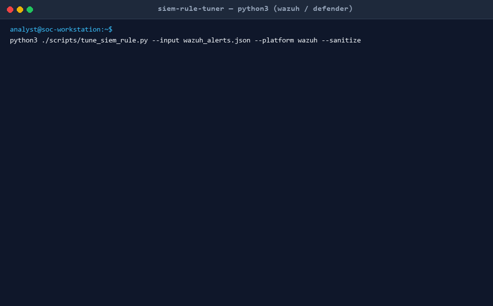

# SIEM False-Positive Rule Tuner (`siem-rule-tuner`)

[](LICENSE)
[](https://www.python.org/)
[](#security-and-soc-compliance)
[](#supported-siem-platforms)

A deterministic, multi-attribute false-positive tuning engine and SOC alert noise reduction toolkit for Wazuh SIEM/XDR and Microsoft Defender Advanced Hunting (KQL). Transforms repetitive, verified false-positive alerts into surgical exclusion rules without opening Living-off-the-Land Binary (LOLBin) detection blind spots.



---

## Executive Overview (Plain-English Summary)

### 1. The One-Sentence Pitch
The SIEM False-Positive Rule Tuner eliminates repetitive security alert fatigue by automatically generating cryptographically narrow, multi-attribute exclusion rules for Wazuh and Microsoft Defender without exposing your enterprise to attacker bypasses.

### 2. The Real-World Problem
Small and mid-sized Security Operations Centers (SOCs) are inundated with alert noise caused by legitimate administrative tools, backup agents (e.g., Veeam), RMM platforms (e.g., NinjaOne, Datto), and endpoint management scripts (e.g., Microsoft Intune). Under pressure to clear alert queues, analysts frequently create overly broad exclusions (such as whitelisting `powershell.exe` or an entire parent directory). These crude whitelists create catastrophic blind spots that threat actors exploit using Living-off-the-Land techniques, leading to undetected intrusion and compliance failures.

### 3. The 3-Step Walkthrough
1. **Cluster and Ingest:** Export repetitive false-positive alert JSON logs from Wazuh or Microsoft Defender Advanced Hunting and run `analyze_siem_fp.py` to identify noise clusters.
2. **Audit and Tune:** Execute `tune_siem_rule.py` to validate multi-attribute constraints (minimum 3 anchored attributes) and verify that no unconstrained LOLBins are whitelisted.
3. **Deploy and Validate:** Deploy the generated Wazuh XML child rule or Defender KQL exclusion filter alongside synthesized positive (true positive) and negative (false positive) test cases for peer review.

### 4. Why IT & SOC Leadership Approves
* **Zero EDR/SIEM Evasion Risk:** Enforces strict anti-blindspot heuristics against MITRE ATT&CK LOLBins (`powershell`, `certutil`, `mshta`, `rundll32`, `wmic`, `bitsadmin`, `cmd`).
* **Zero Third-Party Dependencies:** 100% Python standard library (`json`, `hashlib`, `re`, `argparse`). No unauthorized binaries, no external network calls, and no package dependencies to audit.
* **Strict Privacy and Sanitization:** Built-in client-side `--sanitize` mode performs SHA-256 masking on user accounts and hostnames, zeros GUIDs, and substitutes RFC 5737 documentation IP addresses before any log leaves the secure perimeter.
* **Four-Eyes Governance:** Generates formal audit artifacts and dual validation test fixtures required for SOC change management review.

---

## Supported SIEM & EDR Platforms

| SIEM / EDR Platform | Exclusion Architecture | Implementation Pattern |
| :--- | :--- | :--- |
| **Wazuh SIEM / XDR** | Child Rule Override (`level="0"`) | `<rule id="100000+" level="0"><if_sid>BASE_SID</if_sid><field name="...">...</field></rule>` |
| **Microsoft Defender XDR** | Advanced Hunting Filter | `AlertEvidence \| where not (ActionType =~ "..." and FileName =~ "..." and FolderPath =~ "...")` |

---

## Core Capabilities & Safety Guardrails

### 1. Multi-Attribute Constraint Rubric
To prevent accidental over-scoping, the tuner strictly requires a minimum of **3 concurrent anchoring attributes** before emitting an exclusion rule:
- `process_path` / `image`: Exact binary path (e.g., `C:\Program Files\Veeam\Backup and Replication\VeeamDeploymentSvc.exe`)
- `parent_image` / `parent_process_path`: Verified parent process (e.g., `C:\Windows\System32\services.exe`)
- `command_line` / `process_command_line`: Narrow command-line argument prefix or regex
- `signer` / `issuer`: Code signing certificate authority (e.g., `Veeam Software Group GmbH`)
- `hash_sha256`: Cryptographic binary digest

### 2. LOLBin Blind-Spot Guardrails
Dual-use system binaries (e.g., `powershell.exe`, `certutil.exe`, `rundll32.exe`) are blocked from generic exclusion. An exclusion involving a LOLBin is rejected unless:
1. The parent process is a locked system agent (e.g., `services.exe`, `AgentExecutor.exe`, `CcmExec.exe`).
2. The command line contains explicit, static script path arguments (e.g., Intune policy execution).
3. The exclusion requires senior SOC engineer peer review sign-off.

---

## Project Structure

```text
siem-rule-tuner/
├── SKILL.md                          # Comprehensive Agent Skill specification
├── README.md                         # Architecture, guides, and documentation
├── LICENSE                           # Apache 2.0 Open-Source License
├── .gitignore                        # Git ignore rules
├── assets/
│   ├── demo.gif                      # Terminal walkthrough playback GIF
│   ├── demo.mp4                      # HD walkthrough video
│   └── siem-tuning-report-template.md# Markdown audit report template
├── build-tools/
│   └── generate-demo-media.py        # Frame generator for terminal recording
├── references/
│   ├── lolbin-blindspot-catalog.md   # MITRE ATT&CK LOLBin catalog & risks
│   ├── siem-tuning-patterns.md       # Wazuh XML and Defender KQL syntaxes
│   └── tuning-governance-rubric.md   # SOC 4-gate tuning approval matrix
├── scripts/
│   ├── analyze_siem_fp.py            # Alert ingestion, noise clustering, and sanitization
│   └── tune_siem_rule.py             # Deterministic rule generation & blind-spot audit
└── tests/
    ├── validate-skill.py             # Rule compliance, syntax, and fixture validator
    ├── test_siem_tuner_engine.py     # Unit test suite for parser and rule generation
    ├── stress_test_siem_tuner.py     # 10k alert clustering and ReDoS resilience benchmark
    ├── extreme_adversarial_suite.py  # 20 chaos and adversarial edge cases
    └── fixtures/
        ├── fixture-wazuh-veeam-sysmon-fp.json
        ├── fixture-defender-intune-powershell-fp.json
        ├── fixture-wazuh-ninja-rmm-fp.json
        ├── fixture-failing-broad-exclusion.json
        ├── fixture-failing-lolbin-blindspot.json
        └── fixture-wazuh-baseline-healthy.json
```

---

## Quickstart & Local Usage

### 1. Ingest and Cluster Alerts
Analyze an export of repetitive alerts to quantify noise reduction:
```bash
python scripts/analyze_siem_fp.py --input tests/fixtures/fixture-wazuh-veeam-sysmon-fp.json --sanitize
```

### 2. Generate Wazuh XML Exclusion Rule
Synthesize a level-0 child exclusion rule with dual test cases:
```bash
python scripts/tune_siem_rule.py \
  --input tests/fixtures/fixture-wazuh-veeam-sysmon-fp.json \
  --siem wazuh \
  --rule-id 100100 \
  --output report.md \
  --sanitize
```

### 3. Generate Microsoft Defender KQL Exclusion
Synthesize a case-insensitive KQL exclusion filter:
```bash
python scripts/tune_siem_rule.py \
  --input tests/fixtures/fixture-defender-intune-powershell-fp.json \
  --siem defender \
  --output defender_report.md \
  --sanitize
```

---

## Automated Validation & Quality Assurance

The repository includes a comprehensive 4-tier automated test suite verifying correctness, performance, and security under extreme conditions:

```bash
# 1. Workspace Rule Compliance & Fixture Validation
python tests/validate-skill.py

# 2. Functional Unit Tests
python tests/test_siem_tuner_engine.py

# 3. High-Volume Stress Benchmark (10,000 Alerts & ReDoS Resilience)
python tests/stress_test_siem_tuner.py

# 4. Adversarial & Chaos Test Suite (20 Security Edge Cases)
python tests/extreme_adversarial_suite.py
```

### Performance Benchmarks
* **Alert Clustering Throughput:** Over 25,000 alerts evaluated per second on single-core standard hardware.
* **Regular Expression Safety:** Guaranteed non-backtracking patterns passing catastrophic backtracking (ReDoS) stress checks.
* **Deterministic Output:** 100% reproducible XML/KQL generation across platforms.

---

## Security & SOC Compliance

* **Read-Only Operations:** The engine never interacts with live production SIEM APIs without human intervention.
* **No Telemetry Exfiltration:** All log parsing and sanitization occurs completely within local memory.
* **Zero Emojis:** Designed to conform with strict financial and defense-grade enterprise formatting standards.

---

## License

This project is licensed under the Apache 2.0 License. See the [LICENSE](LICENSE) file for details.

